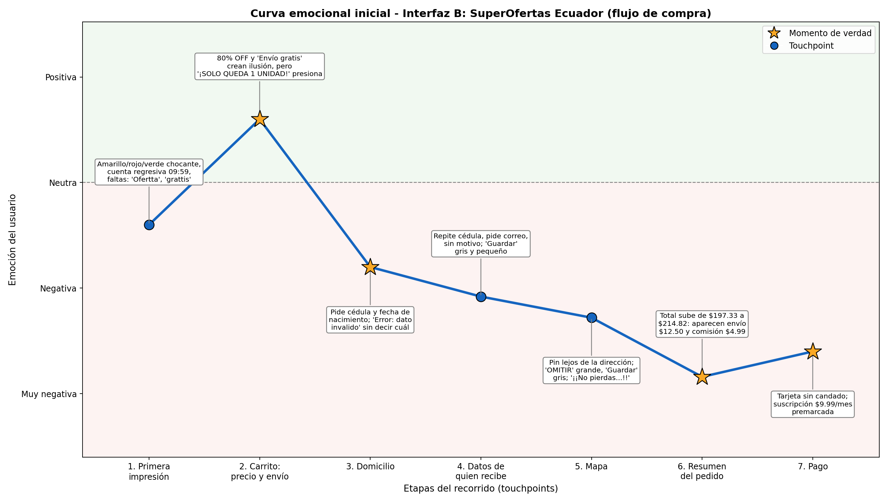
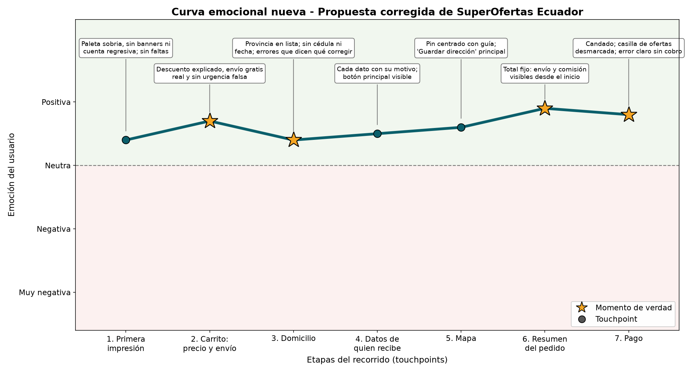
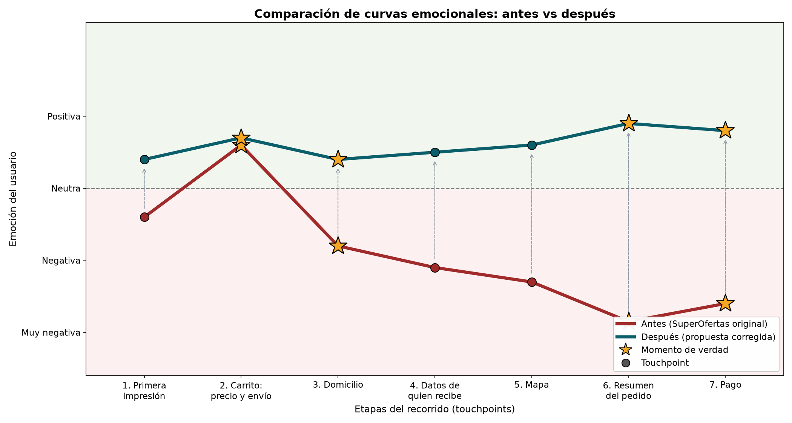
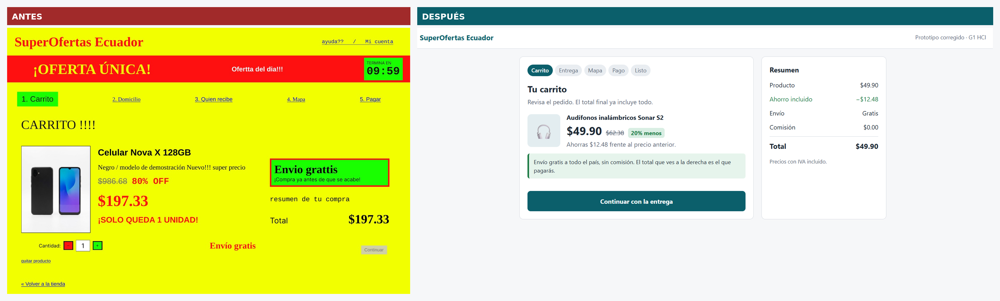
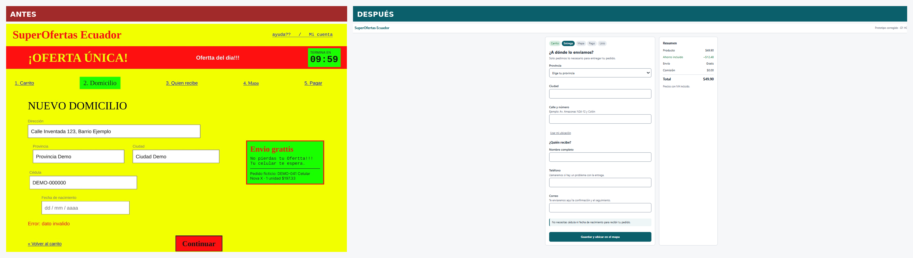
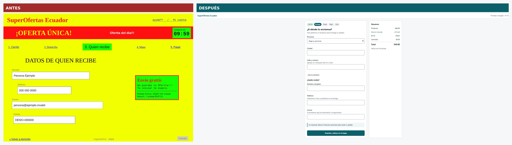
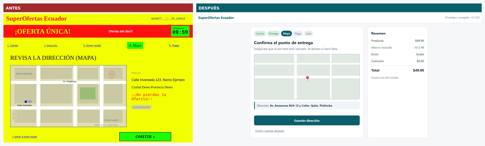
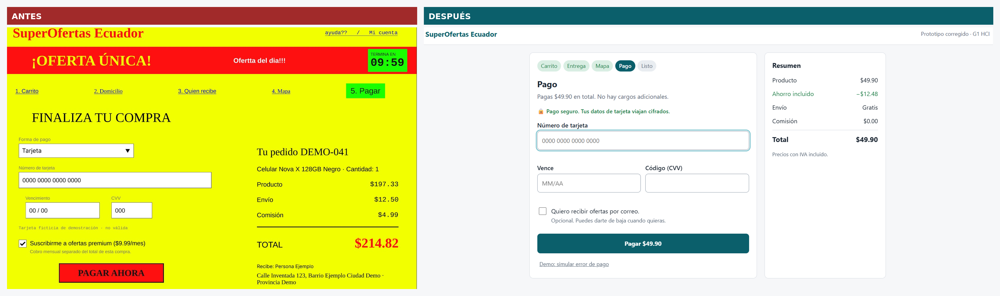

# Comparación antes / después

Compara la interfaz original (con fallos de usabilidad deliberados) contra la propuesta corregida (`src/index.html`), que aplica las 3 mejoras del grupo.

## 1. Curva emocional

| Antes (curva inicial) | Después (propuesta corregida) |
|---|---|
|  |  |

### Las dos curvas en un mismo gráfico

Ambas usan los mismos 7 touchpoints y la misma escala. La estrella marca un **momento de verdad** (carrito, domicilio, resumen del pedido y pago).

> **Nota:** los valores del "antes" se leyeron de la `curva-inicial` (son aproximados). Los del "después" son una **estimación del grupo** sobre la propuesta, no una medición con la clase. Para validarlos, se puede volver a mostrar el prototipo a los compañeros.

## 2. Capturas lado a lado

### Carrito

### Domicilio

### Datos de quien recibe
En la propuesta, el domicilio y los datos de quien recibe están en una sola pantalla de entrega.

### Mapa

### Pago

## 3. Qué cambió en cada momento de verdad

| Momento de verdad | Antes | Después | Mejora |
|---|---|---|---|
| 2. Carrito: precio y envío | "80% OFF" y "Envío gratis" crean ilusión; "¡SOLO QUEDA 1 UNIDAD!" presiona | Descuento explicado con el ahorro real, envío gratis real y sin urgencia falsa | 1 |
| 3. Domicilio | Pide cédula y fecha de nacimiento; "Error: dato inválido" sin decir cuál | Solo los datos necesarios, cada uno con su motivo, y errores que indican qué corregir | 2 |
| 6. Resumen del pedido | El total sube de $197.33 a $214.82 con envío ($12.50) y comisión ($4.99) | Total fijo, con envío gratis y comisión $0 visibles desde el inicio | 1 |
| 7. Pago | Tarjeta sin candado y suscripción de $9.99/mes premarcada | Candado, aviso de pago seguro, casilla de ofertas desmarcada y error que dice que no hubo cobro | 3 |

## 4. Resumen de la mejora

| Indicador | Antes | Después |
|---|---|---|
| Touchpoints con emoción negativa | 6 de 7 | 0 de 7 |
| Momentos de verdad con emoción negativa | 3 de 4 | 0 de 4 |
| Punto más bajo | Resumen del pedido (casi "muy negativa") | Domicilio (algo positiva) |
| Punto más alto | Carrito (positiva, pero es una ilusión que luego se rompe) | Resumen del pedido (positiva) |

En la interfaz original, la emoción sube en el carrito por el descuento y el envío gratis, y cae después cuando aparecen los costos y las trampas. En la propuesta la curva se mantiene estable y positiva, porque no hay sorpresas.

## 5. Cómo se generó
`python generar_comparacion.py` crea las curvas y une las capturas. Los datos de la curva están al inicio del script (`ANTES` y `DESPUES`).